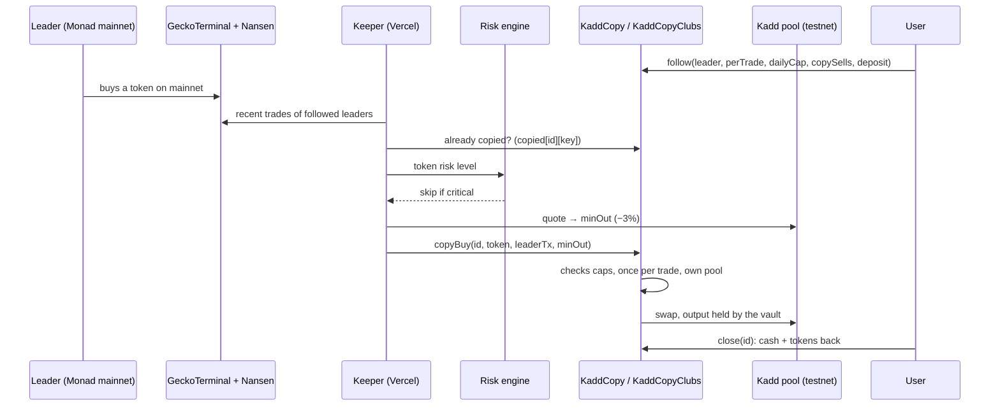
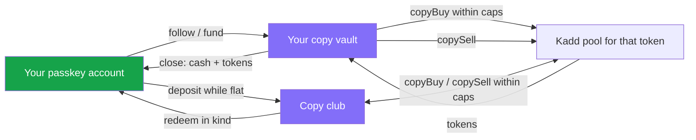

<p align="center">
  
</p>

<h1 align="center">Kadd</h1>

<p align="center">
  Follow Monad's smart money safely. See who is actually winning, backtest copying them, then auto-copy them from a vault whose limits a contract enforces, alone or pooled with friends, and go live on mainnet through Kuru.
</p>

<p align="center">
  <a href="https://kaad-app.vercel.app"></a>
  <a href="https://github.com/maulana-tech/kaad-app"></a>
  <a href="https://testnet.monadexplorer.com/address/0x27bB7D06AF7BA8Ea359CFe00A628145ED0Bf1661"></a>
  <a href="https://www.kuru.io"></a>
  <a href="https://www.nansen.ai"></a>
  <a href="https://envio.dev"></a>
  <a href="https://github.com/category-labs/mera"></a>
  <a href="#hackathon-submission"></a>
</p>

---

Kadd is a social trading terminal for **Monad**. It reads real Monad **mainnet** activity (prices, charts, every
wallet's trades, Nansen smart-money PnL) and lets you act on it: copy one trade with a tap, or let a **copy vault**
follow a wallet for you on Kadd's testnet venue at mainnet prices. When you're ready, the same passkey account trades
live on **mainnet through Kuru Flow**.

> **The keeper decides *when* to copy. The contract decides *what is allowed*.**
>
> - Your money sits in your own vault, not in a bot's wallet. Only you can close it, and closing always works
> - Every copied buy is capped per trade and per UTC day, only trades Kadd's pool for that token, and is copied once
> - A buggy or hostile keeper can at worst trade inside your limits. It cannot move funds anywhere but back to you

---

## Demo

**[kaad-app.vercel.app](https://kaad-app.vercel.app)**: open it, tap **Try it in 60 seconds**, and you have an
account, gas and a confirmed copy trade in about a minute, with a timer running from arrival. No wallet extension, no
seed phrase, nothing to install.

<!-- Demo video: add the link here once it's recorded (script in SUBMISSION.md). -->

| # | Try this | Where |
|---|---|---|
| 1 | Passkey sign-in, automatic gas, copy a trader's latest buy | `/start` |
| 2 | Who is profitable on Monad (Nansen, 30-day PnL) and everyone trading right now | Leaderboard → Smart Money / Monad mainnet |
| 3 | A wallet's trades, holdings, `.nad` name and copy backtest | Any wallet page |
| 4 | Auto copy with a per-trade and daily limit, stop and withdraw anytime | Wallet page → Start auto copy |
| 5 | A copy club: friends pool into one vault that copies one wallet | Groups & Clubs → New copy club |
| 6 | Trade on mainnet through Kuru, with the guaranteed minimum shown first | Token page → Live · Kuru |
| 6b | Long or short BTC on Perpl from the same passkey, AUSD in and out | `/perps` |
| 7 | Everything onchain: trades, copy vaults, clubs, invites | Stats |

---

## What Makes Kadd Special

### Who This Is For

Meet Dimas, who trades Monad memecoins from his phone between classes. He follows a handful of wallets he trusts and
a few callers in Telegram groups. When one of them buys, he finds out from a screenshot minutes later, opens a wallet
app, pastes the contract address, and buys the top. Sometimes he sizes too big because he's chasing.

He has looked at copy-trading bots. Every one of them wants his private key or full control of a wallet, with no
limit he can actually check. And he has no idea whether the wallets he copies are any good, or just lucky last week.

Dimas's problem isn't a missing button. **Following someone means acting late, unsized and on trust.**

---

### The Problem

- **Copying is manual and late.** Screenshot, open a wallet, paste an address, buy, minutes after the move
- **Nobody knows who is actually good.** "Smart money" is a claim; there's no easy way to check a wallet's record
- **Copy bots ask for your keys.** Handing a bot your wallet gives it unlimited power over everything in it
- **No limits.** Nothing stops a bad day from turning into an empty wallet
- **Crypto onboarding kills the moment.** Extensions, seed phrases and gas stand between curiosity and the first trade

**How might we let anyone follow the best Monad traders automatically, with limits a contract enforces and without
handing anyone their keys?**

---

### The Solution

**1. See who is actually winning.** Nansen's smart-money PnL, every wallet trading Monad right now, and a **copy
backtest** per wallet: what copying its buys with $10 each would have returned, on its real trades.

**2. Copy in one tap, or automatically.** **Copy $10** mirrors a single trade. **Auto copy** funds a `KaddCopy` vault:
the keeper watches the leader on mainnet and copies new trades on Kadd's testnet venue within your limits.

**3. Limits in the contract, not in a promise.** `follow(leader, perTrade, dailyCap, copySells, deposit)` fixes the
rules. The contract caps every buy, counts the daily spend, copies each leader trade once and keeps the output in your
vault. `close(id)` always returns everything.

**4. Together: copy clubs.** Friends pool test USDC into one vault that copies one wallet. Deposits are only accepted
while the club is flat (so nobody joins at a manipulated price) and every member redeems their share in kind, anytime.

**5. One passkey, testnet to mainnet.** Mera derives the account from a passkey: no seed phrase, prompt-free signing,
gas sent to new accounts. The same account trades live on Monad mainnet through **Kuru Flow**.

---

## How Auto Copy Works

```
leader trades on Monad mainnet ──► keeper sees it ──► risk guard ──► KaddCopy.copyBuy / copySell ──► Kadd pool (testnet)
                                   (decides when)     (skips critical)  (decides what's allowed)
```

| Guard | Where | What it enforces |
|---|---|---|
| **Per-trade cap** | `KaddCopy` / `KaddCopyClubs` | A copied buy spends at most `perTrade` (vaults) or `perTradeBps` of the club's cash (clubs) |
| **Daily cap** | Same | All copied buys together stay under `dailyCap` per UTC day |
| **Once per trade** | Same | `copied[id][keccak(leaderTx, token)]`: a leader trade is never copied twice |
| **Own pool only** | Same | Swaps only on Kadd's pool for that token, output stays in the vault |
| **Minimum out** | Keeper + contract | The keeper quotes the pool and sets `minOut` 3% below; the swap reverts below it |
| **Risk guard** | [`keeper.ts`](kadd/src/lib/keeper.ts) | Buys of tokens Kadd's risk engine rates *critical* (honeypot or stacked red flags) are skipped |
| **Exit** | `close(id)` / `redeem(id, shares)` | Always available: cash plus every token held, back to the owner |

The keeper runs on a cron (`/api/copy/keeper`) and from open app pages. Calling it too often or from several places is
harmless: the contract copies each leader trade once, so extra runs find nothing to do.

---

## Features

- **Try it in 60 seconds**: passkey, gas, copy a trader's latest buy, timed from arrival to the confirmed trade
- **Smart Money leaderboard**: Nansen's profitable Monad wallets with 30-day PnL, win rate and SMART badges
- **Monad mainnet board**: everyone trading Kadd's tokens now, by volume, activity, net flow or copy ROI
- **Wallet pages**: recent trades, holdings, `.nad` name and avatar, copy backtest, "N copying" from Kadd vaults
- **Copy $10**: one tap mirrors a trade on testnet with free test USDC (claimed for you on the first buy)
- **Auto copy vaults**: per-trade and daily limits, copy sells or not, stop and withdraw anytime
- **Copy clubs**: pooled auto copy with rules fixed at creation, deposits while flat, exit in kind anytime
- **Clubs**: pooled funds where a captain trades within a contract cap and anyone exits with their share
- **Strategies**: limit buy, take-profit, stop-loss and DCA orders that execute onchain
- **Token pages**: live mainnet chart (1m to 1D), trades, a 0–100 risk score with the reason for every point
- **Live · Kuru**: buy and sell on Monad mainnet routed by Kuru Flow, with a review step showing the guaranteed minimum
- **Perps from your passkey (Perpl)**: AUSD in, long or short BTC / ETH / SOL / MON with up to 10×, close, withdraw, on testnet or mainnet; the liquidation price is shown before you sign; Get AUSD swaps MON → AUSD on Kuru
- **Perps leaderboard (Perpl)**: every open perps position on Monad mainnet with leverage and open PnL, 30-day realized PnL per trader, and Kadd's copy bot mirroring one of them on testnet
- **Best auto copy leaderboard**: every live vault and copy club ranked by return
- **Share cards**: wallet and vault links unfold into image cards with live numbers on X and Telegram
- **Invites, counted onchain**: shared links carry `?ref=`, `KaddReferrals` records the inviter once, Stats shows who
  went on to trade
- **Notifications**: in-app and browser notifications, plus **Telegram alerts** that work with Kadd closed
- **Network stats**: trades, volume, wallets, clubs, copy vaults and invites, read from the contracts and the indexer
- **AI agent skills**: five skills and a public JSON API, so Claude, Cursor or Codex can research and trade with Kadd

---

## Tech Stack

| Layer | Technology |
|---|---|
| Contracts | Solidity 0.8.28, Foundry (96 tests, plus fork tests against real Kuru Spot V2 and Kuru Flow) |
| Chain | Monad testnet (chain 10143) for trading practice, Monad mainnet for market data and live trades; contracts verified on Sourcify |
| Frontend | Next.js 16 (App Router), React 19, Tailwind CSS v4, lightweight-charts, GSAP + Lenis |
| Accounts | [Mera](https://github.com/category-labs/mera) passkeys (PRF → signing session), viem 2 |
| Market data | CoinGecko onchain API / GeckoTerminal, DexScreener, Nansen, Nad Name Service |
| Mainnet trading | Kuru Flow (quote, build, passkey signs) |
| Indexing | Envio HyperIndex (live on Envio Cloud) and HyperRPC for event history |
| Backend | Next.js route handlers on Vercel: keeper, gas drip, agent API, Telegram webhook |
| Storage | Onchain for everything that moves money; Upstash Redis (REST) only for Telegram subscriptions |
| Share cards | `next/og` (Satori) image routes per wallet and vault |
| Tests | Foundry (96), an indexer replay test on real chain history, 10 self-checks for the data logic |

---

## Monad Integration

| Component | File | Description |
|---|---|---|
| **KaddCopy** | [`KaddCopy.sol`](contracts/src/testnet/KaddCopy.sol) | Auto copy vaults: one leader, per-trade and daily caps, copy each leader trade once, close anytime |
| **KaddCopyClubs** | [`KaddCopyClubs.sol`](contracts/src/testnet/KaddCopyClubs.sol) | Pooled auto copy: shares, deposits only while flat, redeem in kind, limits as a share of cash |
| **KaddClub + Factory** | [`KaddClub.sol`](contracts/src/KaddClub.sol) | Captain-traded clubs, each buy capped at `maxTradeBps` of the club's USDC; runs on Kuru's interface |
| **KaddStrategies** | [`KaddStrategies.sol`](contracts/src/testnet/KaddStrategies.sol) | Limit, take-profit, stop-loss and DCA orders anyone can execute when triggered |
| **KaddVenue** | [`KaddVenue.sol`](contracts/src/testnet/KaddVenue.sol) | Testnet stand-in for Kuru (AccountCore / OrderBook interface): one pool per mainnet token at its mainnet price, tUSDC faucet |
| **KaddReferrals** | [`KaddReferrals.sol`](contracts/src/testnet/KaddReferrals.sol) | Onchain invite attribution, once per account |
| **KaddCopyKuru** | [`KaddCopyKuru.sol`](contracts/src/KaddCopyKuru.sol) | Mainnet auto copy in MON through the Kuru Flow router. Built and fork-tested, **not deployed** |
| **Keeper** | [`keeper.ts`](kadd/src/lib/keeper.ts) | Turns new leader trades into `copyBuy` / `copySell`, simulates first, risk guard |
| **Passkey wallet** | [`wallet.ts`](kadd/src/lib/wallet.ts) | Mera account, signing session, same address on testnet and mainnet |

Kuru's testnet order books are empty and only list governance-whitelisted tokens, so practice trading runs on
`KaddVenue`, which speaks Kuru's interface. `KaddClub` runs unchanged on both and is fork-tested against real Kuru.

## Partner Integrations

| Partner | What Kadd uses it for | Where |
|---|---|---|
| **Nansen** | Smart-money PnL leaderboard: Smart Money tab, SMART badges, wallet cards, `/start` picks, agent API. One paid call a day, shared | [`NANSEN.md`](NANSEN.md), [`nansen.ts`](kadd/src/lib/nansen.ts) |
| **Kuru** | Live mainnet trades through Kuru Flow (quote → review with minimum → passkey signs); `KaddCopyKuru` for mainnet auto copy; `KaddClub` fork-tested on Kuru Spot V2 | [`kuru.ts`](kadd/src/lib/kuru.ts), [`KuruTrade.tsx`](kadd/src/components/KuruTrade.tsx) |
| **Envio** | Multichain HyperIndex indexer: every Kadd contract (testnet) and Perpl's realized PnL (mainnet), swaps attributed to whoever's money it was; HyperRPC for event history and the chart fallback | [`indexer/`](indexer/), [`events.ts`](kadd/src/lib/events.ts) |
| **Mera** | The whole account layer: one passkey ceremony, prompt-free signing, no seed phrase | [`wallet.ts`](kadd/src/lib/wallet.ts) |
| **Perpl** | Perps trading from the passkey account straight on the Exchange contract (`createAccount`, `execOrder`); perps leaderboard and market analytics (volume, OI, long/short, leverage, funding, positions near liquidation) from the Exchange contract (open positions, leverage, open PnL) and the indexer (30-day realized PnL); Kadd's copy bot mirrors a mainnet trader on Perpl testnet through the API | [`perpl.ts`](kadd/src/lib/perpl.ts), [`perplBot.ts`](kadd/src/lib/perplBot.ts) |
| **Nad Name Service** | `.nad` names and avatars for wallets | [`nns.ts`](kadd/src/lib/nns.ts) |

## AI Agent Integration

| Component | File | Description |
|---|---|---|
| **Skills** | [`skills/`](skills/) | `kadd-market`, `kadd-token`, `kadd-wallet`, `kadd-smart-money`, `kadd-trade`: `npx skills add maulana-tech/kaad-app` |
| **Agent API** | [`api/agent`](kadd/src/app/api/agent/) | Public JSON API (`/api/agent/help`): markets, tokens, wallets, smart money, copy vaults |
| **Signing** | | Trades come back as `cast` plans the agent signs with its own testnet key; Kadd never sees one |

---

## Architecture

### Copy flow



### Where the money can go



Every path out of a vault or club ends in its owner's account. The keeper has no other path.

---

## Setup

### Requirements

- Node 22+ and npm
- [Foundry](https://getfoundry.sh) for the contracts
- Optional keys: CoinGecko (Demo plan), Envio API token, Nansen, a testnet-only gas drip / keeper wallet; Telegram and
  Upstash for alerts

### Run locally

```bash
git clone https://github.com/maulana-tech/kaad-app.git
cd kaad-app

# Contracts
cd contracts && forge test && cd ..

# App against the live testnet deployment (no keys needed for most pages)
cd kadd
cp .env.example .env.local
npm install && npm run dev        # http://localhost:3000

# Indexer
cd ../indexer && pnpm install && pnpm codegen && pnpm test
```

Every unset contract address falls back to the live testnet deployment.

### Scripts

```bash
npm run dev / build / lint                                      # app
npx tsx --conditions=react-server src/lib/<name>.check.ts       # self-checks: cache, events, keeper, leaderboard, market, onchain, perplBot, perplOrder, telegram, wallets
node contracts/export-abi.mjs                                   # ABIs for the app, after forge build
node contracts/export-deployments.mjs                           # contracts/deployment.json from broadcasts
eval "$(node script/kuru-quotes.mjs)" && forge test --match-contract KaddCopyKuruFork --fork-url https://rpc.monad.xyz   # mainnet fork test on a real Kuru Flow route
```

Guides: [Telegram alerts setup](docs/telegram-setup.md), [indexer deploy](indexer/README.md), [phase-2 spec](docs/phase-2-spec.md).

> **Two traps worth knowing.** tUSDC has **6 decimals** and mirror tokens have 18. And the public Monad testnet RPC
> rate-limits shared cloud IPs: server reads are batched with multicall and cached, so keep it that way.

---

## How It Works

### First trade

```
Landing → Try it in 60 seconds → passkey → gas arrives → pick a trader → Copy $10 → confirmed
```

### Auto copy

```
Wallet page → Start auto copy → set $ per buy, $ per day, copy sells → fund the vault → keeper copies → Stop & withdraw
```

1. **Pick**: a wallet from Smart Money or the mainnet board, checked with its backtest
2. **Set limits**: per buy, per day, whether to exit when the leader sells
3. **Fund**: tUSDC into the vault, one transaction, signed by the passkey without a prompt
4. **Copy**: new leader trades are copied within minutes, each one shown on the vault page and as a notification
5. **Stop**: `close` returns cash and every token, anytime

### Copy club

```
New copy club → name, leader, % per buy, % per day → first deposit → share the link → friends join while flat → redeem anytime
```

### Live on mainnet

```
Token page → Live · Kuru → amount → Kuru Flow quote → review (guaranteed minimum) → passkey signs → mainnet tx
```

---

## Contract Details

### Addresses (Monad testnet, chain 10143, all verified on Sourcify, exact match)

| Contract | Address |
|---|---|
| KaddVenue (pools + tUSDC faucet) | [`0xe4c0c88a4b2e5b150D3bB8D3d391E6A87b3d5379`](https://testnet.monadexplorer.com/address/0xe4c0c88a4b2e5b150D3bB8D3d391E6A87b3d5379) |
| KaddCopy (auto copy vaults) | [`0x27bB7D06AF7BA8Ea359CFe00A628145ED0Bf1661`](https://testnet.monadexplorer.com/address/0x27bB7D06AF7BA8Ea359CFe00A628145ED0Bf1661) |
| KaddCopyClubs (pooled auto copy) | [`0x67A974949d2918e07763C86cfe8bbc3E817930D2`](https://testnet.monadexplorer.com/address/0x67A974949d2918e07763C86cfe8bbc3E817930D2) |
| KaddClubFactory (clubs on the venue) | [`0x4E24bA0762624EAa63E02f3834105efa423A624c`](https://testnet.monadexplorer.com/address/0x4E24bA0762624EAa63E02f3834105efa423A624c) |
| KaddClubFactory (clubs on Kuru Spot V2) | [`0xcF7e32d79553aA97259724bb780b951115F5b647`](https://testnet.monadexplorer.com/address/0xcF7e32d79553aA97259724bb780b951115F5b647) |
| KaddStrategies (limit / TP / SL / DCA) | [`0xC12684b7063e3C749f0227539601a7b370073cEA`](https://testnet.monadexplorer.com/address/0xC12684b7063e3C749f0227539601a7b370073cEA) |
| KaddReferrals (onchain invites) | [`0xFe2FD41200AF425A441261d1c6d6fC5f703B782d`](https://testnet.monadexplorer.com/address/0xFe2FD41200AF425A441261d1c6d6fC5f703B782d) |
| KaddCore (venue account core) | [`0x3f8674797756ceba5a217830b6f74a00bf89da70`](https://testnet.monadexplorer.com/address/0x3f8674797756ceba5a217830b6f74a00bf89da70) |
| tUSDC (6 decimals, faucet) | [`0x9173048f7c1D6ebfC72a1932C8d15E3EADE180CB`](https://testnet.monadexplorer.com/address/0x9173048f7c1D6ebfC72a1932C8d15E3EADE180CB) |

Mirror pools: CHOG, MOLANDAK, emo, FLING, ANAGO, APR, each opened at its mainnet price. Every deployment, deploy
transaction and pool: [`contracts/deployment.json`](contracts/deployment.json). Envio indexer:
[GraphQL endpoint](https://indexer.dev.hyperindex.xyz/2de4d1c/v1/graphql).

### Key Functions

#### KaddCopy: followers and keeper

```
follow(leader, perTrade, dailyCap, copySells, deposit)   # open a vault with its limits
fund(id, amount)                                          # add tUSDC
close(id)                                                 # stop: cash + every token back to the owner, always available
copyBuy(id, source, leaderTx, minOut)                     # keeper: capped buy on Kadd's pool, once per leader trade
copySell(id, source, leaderTx, minOut)                    # keeper: exit the position when the leader sells
```

#### KaddCopyClubs

```
create(name, leader, perTradeBps, dailyCapBps, copySells)  # rules fixed at creation
deposit(id, amount)                                         # only while the club holds no tokens, at cash per share
redeem(id, shares)                                          # in kind: share of cash + share of every token, anytime
copyBuy / copySell(id, source, leaderTx, minOut)            # keeper, limits as a share of the club's cash
```

#### Clubs, strategies, invites

```
createClub(name, maxTradeBps, markets, dust)                # KaddClubFactory
deposit(amount) · redeem(shares) · trade(market, isBuy, amountIn, minOut, deadline)   # KaddClub, captain capped
create(pool, isBuy, amount, perExec, trigger, above, interval) · execute(id) · cancel(id)   # KaddStrategies
register(referrer)                                          # KaddReferrals, once per account
```

#### KaddCopyKuru (mainnet, not deployed)

```
follow(leader, perTrade, dailyCap, copySells)  payable      # MON vault
copyBuy(id, token, leaderTx, minOut, data)                  # Kuru Flow calldata; vault's own balance must rise ≥ minOut
copySell(id, token, leaderTx, minOut, data)                 # approves exactly the position, resets after
close(id)                                                   # always works, even when paused
```

---

## Deployment Checklist

- [x] KaddVenue, KaddCopy, KaddCopyClubs, KaddClubFactory, KaddStrategies and KaddReferrals deployed on Monad testnet, verified on Sourcify
- [x] Six mirror pools opened at mainnet prices
- [x] Auto copy vaults copying real mainnet wallets ([first live copy](https://testnet.monadexplorer.com/tx/0xea138255e9d549667e6b758a6f57135717f3be0e559ceb5d873fdcf3bc91abea))
- [x] Copy clubs, clubs and onchain strategies
- [x] Keeper with simulate-first and a risk guard
- [x] Passkey accounts with automatic gas (Mera)
- [x] Live mainnet trading through Kuru Flow
- [x] Nansen smart money, copy backtests, share cards, notifications, Telegram alerts
- [x] Onchain invites counted on Stats
- [x] Envio indexer live on Envio Cloud
- [x] Foundry tests (96) plus fork tests against real Kuru
- [x] Live demo: [kaad-app.vercel.app](https://kaad-app.vercel.app)
- [ ] `KaddCopyKuru` on mainnet (built and fork-tested; deploying it is a team decision because it holds real funds)
- [ ] Demo video

**Limits worth naming.** Auto copy runs on testnet with test USDC at mainnet prices; the mainnet vault is ready but not
deployed. Groups (as opposed to clubs) are still demo data. The keeper depends on an external cron and the public
testnet RPC.

---

## Hackathon Submission

| | |
|---|---|
| **Event** | Monad Metropolis |
| **Track** | Onchain Finance & Trading |
| **Bounties** | Nansen · Kuru (Consumer Trading App) · Perpl · Agora (Mobile Trading) · Envio · Mera (UX) |
| **Network** | Monad testnet (chain 10143) and Monad mainnet (chain 143) |
| **Live demo** | [kaad-app.vercel.app](https://kaad-app.vercel.app) |
| **Submission notes** | [`SUBMISSION.md`](SUBMISSION.md) |
| **Source** | [github.com/maulana-tech/kaad-app](https://github.com/maulana-tech/kaad-app) |

### Why it fits Onchain Finance & Trading

- **Trading that actually happens onchain.** Swaps, copy vaults, clubs and strategies are real transactions on Kadd's contracts; live trades go through Kuru on mainnet
- **A new market structure.** Non-custodial copy trading where the limits live in a contract, and copy clubs that let friends share one
- **Built on real data.** Mainnet trades, Nansen PnL and backtests decide who is worth following, not follower counts
- **Fast enough to feel like trading.** Monad's sub-second blocks make copying within minutes and prompt-free signing practical

---

## Documentation

| Doc | What's in it |
|---|---|
| [Submission](SUBMISSION.md) | Judging criteria, bounties, demo and pitch scripts |
| [Nansen](NANSEN.md) | How Kadd uses Nansen and its credit budget |
| [Indexer](indexer/README.md) | Entities, attribution and deploying to Envio Cloud |
| [Telegram setup](docs/telegram-setup.md) | Bot, Upstash and webhook in six steps |
| [Perpl setup](docs/perpl-setup.md) | Perps trading, leaderboard, the copy bot and its testnet setup |
| [Phase-3 spec](docs/phase-3-spec.md) | Perps on Kadd: findings, trading from the passkey, analytics |
| [Phase-2 spec](docs/phase-2-spec.md) | Social proof, `/start`, share cards, notifications, copy clubs, mainnet copy |
| [Skills](skills/README.md) | Agent skills and the agent API |

---

> See who's winning. Follow them with limits a contract enforces. Kadd.
